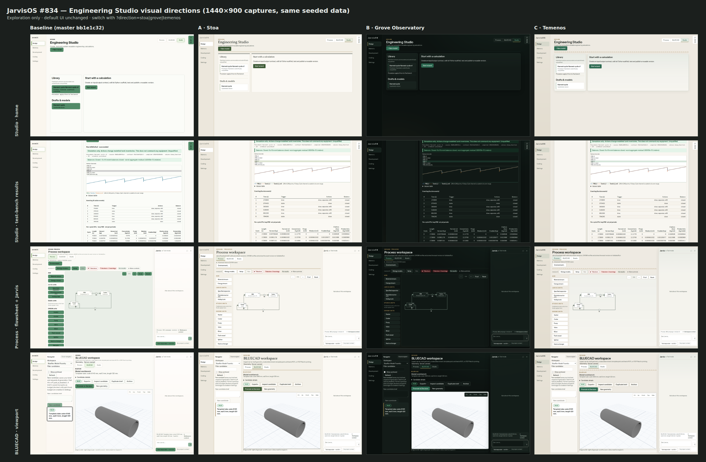

# Engineering Studio visual directions (issue #834)

> **Closed (2026-10-20).** None of these three directions was selected. The maintainer chose **Lumen** in a later exploration round (branch `explore/198b-lumen-v2`); the accepted contract is [spec 198](../../specs/198-studio-visual-design.md). This page is kept as discovery history.

These are browser captures of three reversible CSS explorations on the existing Engineering Studio, Process, and BLUECAD screens. They are **choices for maintainer review**, not an approved redesign. The preview code and full capture harness remain in the local exploration worktree; no preview CSS is part of this planning change. The screenshots use seeded test data, not private research data.

| Direction | Character | Main delivery consideration |
| --- | --- | --- |
| **A — Stoa** | Warm mineral ground, olive ink, bronze rules, restrained classical serif headings. | A bundled serif would give consistent cross-platform typography. |
| **B — Grove Observatory** | Basalt surfaces, viridian controls, quiet gold focus and selection. | A complete dark treatment needs more component and BLUECAD viewport work; the current canonical default is light. |
| **C — Temenos** | Warm limestone, muted green glass, bronze detail, subtle Hellenic geometry. | The repeated header ornament needs restraint during implementation. |

The local exploration recommends **C** as the closest fit to the requested nature, machinery, and Hellenic direction with a light default and bundled fonts. That recommendation does not select it. The maintainer may choose A, B, C, or ask for a revision. No broad implementation is authorized until a direction is chosen and spec 198 is made `ready`.

## Inspect full-size screens

| Screen | Current | A — Stoa | B — Grove | C — Temenos |
| --- | --- | --- | --- | --- |
| Studio home | [image](baseline-01-studio-home-1440.png) | [image](stoa-01-studio-home-1440.png) | [image](grove-01-studio-home-1440.png) | [image](temenos-01-studio-home-1440.png) |
| Studio results | [image](baseline-02-studio-results-1440.png) | [image](stoa-02-studio-results-1440.png) | [image](grove-02-studio-results-1440.png) | [image](temenos-02-studio-results-1440.png) |
| Process | [image](baseline-03-process-1440.png) | [image](stoa-03-process-1440.png) | [image](grove-03-process-1440.png) | [image](temenos-03-process-1440.png) |
| BLUECAD | [image](baseline-04-bluecad-1440.png) | [image](stoa-04-bluecad-1440.png) | [image](grove-04-bluecad-1440.png) | [image](temenos-04-bluecad-1440.png) |

## Evidence and limits

The exploration used `bb1e1c3288346f57da220cf9d2fdadede5a8d628` as its baseline. Each direction was captured in Chromium at 1440 × 900 against the same seeded local backend. The patched app's default screenshots matched a pristine baseline byte for byte across five captured views. The patched frontend build passed, and the capture log recorded no page or console errors. A computed-colour audit of visible text on those views reported no AA text-contrast failures in the three proposals. The local capture artifacts and measurement scripts are under `/home/thera/jarvis-control/work/out/v834-design/`.

This evidence supports choosing a direction. It does **not** establish acceptance for a production redesign: narrow layouts, keyboard use, all UI states, complete dark parity, and end-to-end workflow parity still need exact-head proof under a ready spec. The browser capture includes the BLUECAD viewport; B leaves its current light 3D scene visible, as shown.
