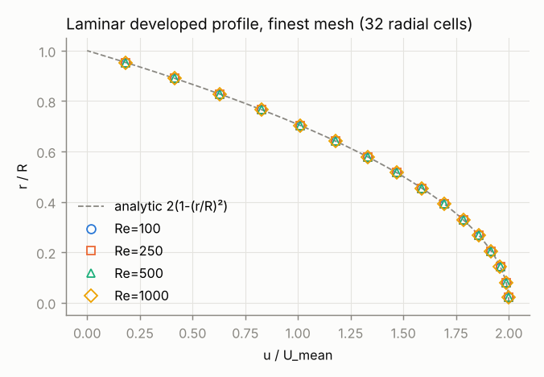
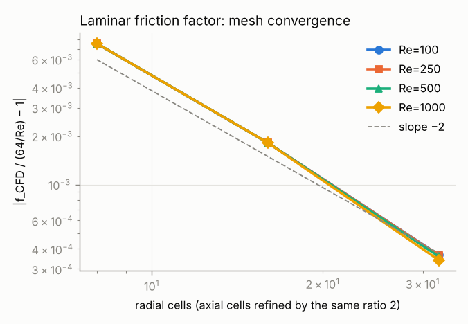
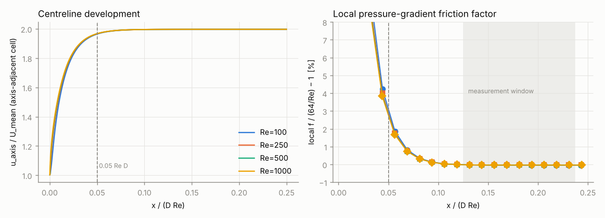
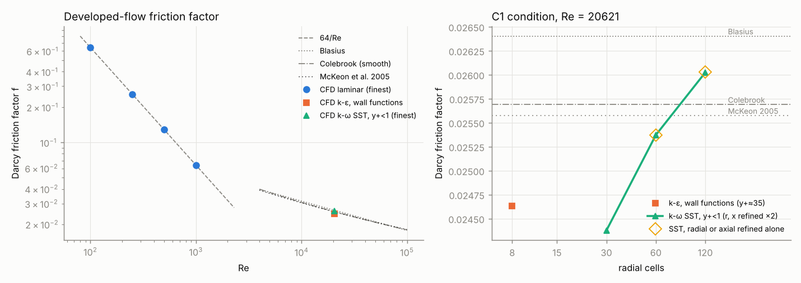
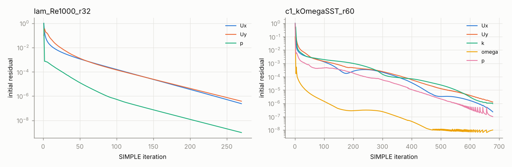

# OpenFOAM smooth-pipe prototype: evidence (cloud lane, issue #913)

Status: **prototype evidence for #901 Phase 2**. No spec number; not wired into the
backend; not scheduled supervisor work. The maintainer decides whether Phase 2 adopts,
adapts or discards it.

Code: `prototypes/openfoam_pipe/`. All numbers below come from one command run at commit
`9f30455` (recorded in `evidence/results.json` → `tools.git_head_at_run`):

```bash
python3 -m prototypes.openfoam_pipe --work /tmp/pipe_cases --out prototypes/openfoam_pipe/evidence
```

The run takes 20 cases, 4380 CPU-s in total, about 41 min wall on 4 cores. The finest
SST mesh accounts for 2442 s of that. All 20 cases passed the convergence and mass gates
(`"issues": {}`). The figures were then re-rendered from `results.json` by `plots.py`
after a layout-only change; no number changed. Later commits on the branch are
lint-only (`ruff check --config backend/pyproject.toml` clean: `zip(strict=True)`, unquoted
annotations), and `--quick` plus the tests re-run green after them.

## Environment and versions

| Item | Value |
|---|---|
| OS | Ubuntu 24.04.5 LTS, 4 vCPU, 15 GB RAM (Claude Code cloud container) |
| OpenFOAM | v1912 (ESI), Ubuntu package `openfoam 1912.200626-2build3` |
| Gmsh | `gmsh` / `python3-gmsh 4.12.1+ds1-1.1build2` (installed and recorded; not used, see below) |
| Python | 3.13, pydantic 2.13, numpy 2.5, matplotlib 3.11, PyVista 0.49.1 |

The binaries need `WM_PROJECT_DIR=/usr/share/openfoam`; `foam_io.foam_env()` sets it.

**Packaging defect found.** In this Ubuntu build, every OpenFOAM function object aborts
in `dictionary::digest()` with `error in IOstream "sha1"`. That covers any `functions`
entry in `controlDict` and `postProcess -func …`, so `wallShearStress`, `yPlus`,
`writeCellCentres` and `surfaceFieldValue` are all unusable. The prototype avoids them:

- cell centres and volumes are computed from `constant/polyMesh` with OpenFOAM's own
  face-triangle / cell-pyramid decomposition. Cell volumes match
  `checkMesh -writeAllFields` to 5e-12, and their sum equals the pipe volume share to 1e-9;
- wall shear stress and y+ are computed from the wall-adjacent cell as
  ρ(ν + ν_t,wall)·|U_t|/y_P. This is what `wallShearStress` does on an orthogonal mesh.

Phase 2 should either pin a different OpenFOAM build (for example the openfoam.com
v2406+ packages, if reachable) or keep this independent post-processing.

## Contract → case

`contract.PipeCase` is a pydantic model with `extra="forbid"`, `frozen=True` and these fields:

- D, L, fluid (ρ, μ);
- inlet: exactly one of mean velocity or flow rate, plus turbulence intensity and mixing length;
- outlet gauge pressure;
- mesh: radial and axial cells, radial grading, wedge angle;
- model: `laminar | kOmegaSST | kEpsilon`;
- solver: residual target and maximum iterations.

Validators reject:

- laminar at Re > 2000;
- RANS at Re < 4000;
- L < 5 D;
- both or neither of velocity and flow rate.

`casegen.generate()` maps a contract to a complete case: `system/blockMeshDict`, `controlDict`,
`fvSchemes`, `fvSolution`, `constant/transportProperties`, `turbulenceProperties`, and
`0/U`, `0/p`, plus `k`, `omega` or `epsilon`, and `nut` for RANS. Generation goes through a typed
serializer (`foam_dict.py`) that has no free-text path, so the same contract always gives
byte-identical files (tested). `write_case` also writes `jarvis_case_manifest.json` with the
contract, the derived Re and Q, and a SHA-256 per file.

**Geometry choice: 2D-axisymmetric wedge (2°), blockMesh, not Gmsh.** A straight pipe with
uniform axisymmetric inflow has an axisymmetric steady solution. That holds exactly for
laminar flow and by construction for the RANS mean flow. One azimuthal cell therefore resolves the same
physics as a 3D pipe at a tiny fraction of the cost, which is what made a 3-level mesh study
at y+ < 1 feasible on 4 cores. The structured wedge also gives exact systematic refinement
(ratio 2 in r and x).

The wedge corner radius is set to R·√(θ/sin θ). The flat triangular cross-section then has
exactly the sector area θR²/2, so the imposed velocity yields the contract flow rate to
1e-12. Gmsh → `gmshToFoam` is the natural route once Phase 2 has CAD fluid domains
(helical insert, Smart Joint). It was not needed for a straight tube.

Numerics, identical for all cases:

- `simpleFoam` with SIMPLEC (`consistent yes`), U relaxation 0.9;
- `bounded Gauss linearUpwind grad(U)`, `limitedLinear 1` for turbulence;
- `Gauss linear corrected` laplacians;
- p: GAMG with DICGaussSeidel smoother and direct coarsest solve. The plain GaussSeidel smoother needed about 190 cycles per
  solve on the ~600:1 near-wall cells.

`residualControl` is applied to p, k, ω and ε, but not U. On a wedge the out-of-plane Uz is about 0 and its
normalised residual is round-off noise that never decreases. Ux and Uy are instead gated after
the run (≤ max(100 × target, 1e-6)), and iterative error in f is measured directly (see below).

## Laminar validation (Re = 100, 250, 500, 1000)

**Setup.**
- Fluid and geometry: water at 20 °C (ρ = 998.2 kg/m³, μ = 1.002e-3 Pa·s), D = 10 mm,
  uniform plug inlet, outlet p = 0.
- Pipe length L = max(25 D, 0.25 Re D).
- Developed quantities are measured over x ∈ [0.5 L, 0.95 L], which is [0.125, 0.2375] Re D.
- ΔP/L comes from a linear fit of the area-averaged pressure over that window. It is
  cross-checked against 4τ_w/D from the wall shear stress.

**Why such a long pipe.** The first full run used L = 0.15 Re D, with the window starting at
0.075 Re D. It showed a reproducible +0.1 % bias. The local pressure gradient is still
0.3 % above Hagen–Poiseuille at 0.075 Re D and settles to within 0.01 % only beyond about
0.1 Re D (figure below, right). The textbook entrance length of about 0.05 Re D describes the
centreline velocity, not a pressure gradient accurate to 0.1 %. The study now reports this
development curve for every case.

### Friction factor vs Hagen–Poiseuille (f = 64/Re)

| Re | f/f_HP − 1, mesh 8 × L·8/(4D) | 16 radial cells | 32 radial cells | observed order p | Richardson-extrapolated f/f_HP − 1 | GCI_fine |
|---|---|---|---|---|---|---|
| 100 | −0.755 % | −0.182 % | **−0.037 %** | 1.97 | +0.013 % | 0.062 % |
| 250 | −0.755 % | −0.182 % | **−0.037 %** | 1.97 | +0.013 % | 0.062 % |
| 500 | −0.755 % | −0.182 % | **−0.036 %** | 1.97 | +0.015 % | 0.063 % |
| 1000 | −0.755 % | −0.182 % | **−0.034 %** | 1.95 | +0.018 % | 0.065 % |

Cells on the finest mesh: 6 400 / 16 000 / 32 000 / 64 000 (32 radial cells, 1 axial cell per
8 radial cell sizes). The observed order of about 1.96 matches the formal second order of the
schemes. The extrapolated values bracket the analytic answer within 0.02 %.

**Acceptance (stated tolerance).** |f/f_HP − 1| ≤ 0.1 % on the finest mesh, with GCI ≤ 0.1 %.
Met at all four Re (max 0.037 %, max GCI 0.065 %).

### Other laminar checks (finest mesh)

| Check | Result |
|---|---|
| Profile u/U vs 2(1 − (r/R)²) at x = 0.95 L, error normalised by 2U | max ≤ 0.099 %, rms ≤ 0.040 % |
| Wall-shear ΔP (4τ_w/D) vs Hagen–Poiseuille | −0.040 % to −0.042 % (−0.76 % → −0.19 % → −0.04 % with refinement) |
| Mass: (Q_out − Q_in)/Q_in from boundary face fluxes | ≤ 4e-11 (all 12 laminar runs) |
| Flow rate vs contract: Q_in · 360/θ / Q_contract − 1 | ≤ 5e-12 |
| SIMPLE iterations to p residual 1e-9 | 118–270 |
| Iterative error: target 1e-9 → 1e-10 (Re 500, 16 radial cells) | Δf/f = −1.5e-8 |





## C1-like turbulent run (D = 46 mm, U = 0.45 m/s, water at 20 °C → Re = 20 621)

The culture is approximated as Newtonian water at 20 °C (ν = 1.004e-6 m²/s). That is an
assumption: a real culture's viscosity and its possible non-Newtonian behaviour would shift Re
and f.

Other settings:
- Pipe length L = 100 D, measured over 60–95 D. Beyond 60 D, f from local 5 D windows stays within ±0.04 % of the window value on every mesh (`local_darcy_f` in `results.json`).
- Inlet: uniform velocity, turbulence intensity 5 %, mixing length 0.07 D.
- Residual target 1e-6 for p, k and ω (or ε).

Reference values at this Re:

| Correlation | f | ΔP/L [Pa/m] |
|---|---|---|
| Blasius 0.3164 Re^−0.25 | 0.02640 | 58.0 |
| Colebrook, ε = 0 (Prandtl–Kármán smooth law) | 0.02569 | 56.4 |
| McKeon et al. 2005 (superpipe fit) | 0.02557 | 56.2 |

The correlations themselves span 3.2 % at this Re.

### k-ω SST, low-Re wall treatment

Wall-adjacent y+ is below 1 on every mesh. Wall boundary conditions: k = 0, `omegaWallFunction`,
`nutLowReWallFunction`. The radial grading is a fixed total ratio of 0.029, and refinement is ×2 in
both r and x.

| Mesh (r × x) | cells | y+ (cell centre) | f | ΔP/L [Pa/m] | vs Blasius | vs Colebrook | vs McKeon |
|---|---|---|---|---|---|---|---|
| 30 × 200 | 6 000 | 0.97 | 0.02438 | 53.6 | −7.7 % | −5.1 % | −4.7 % |
| 60 × 400 | 24 000 | 0.50 | 0.02537 | 55.7 | −3.9 % | −1.2 % | −0.8 % |
| 120 × 800 | 96 000 | 0.26 | **0.02602** | **57.2** | −1.4 % | **+1.3 %** | +1.8 % |
| GCI triplet | | | p = 0.61 (monotonic), extrapolated f = 0.02726, **GCI_fine = 5.9 %** | | | | |

**Split refinement (diagnostic).**

| Mesh (r × x) | f | Compared with |
|---|---|---|
| 120 × 400 | 0.026031 | 120 × 800: 0.026024 |
| 60 × 800 | 0.025371 | 60 × 400: 0.025372 |

Axial resolution is irrelevant: the dependence is entirely radial.

**Iterative error.** Tightening the 30 × 200 run from 1e-6 to 1e-8 changes f by −3.0e-5
(relative).

**Consistency checks.**
- Wall-shear and pressure-gradient ΔP agree within 0.02 % on every mesh: the momentum balance closes.
- Mass imbalance is ≤ 1e-8.

### k-ε, standard wall functions

Uniform 8 × 400 mesh, wall-adjacent y+ ≈ 35. Wall boundary conditions: `kqRWallFunction`,
`epsilonWallFunction`, `nutkWallFunction`. f = 0.02463 (ΔP/L = 54.1 Pa/m):

| Correlation | Error |
|---|---|
| Blasius | −6.7 % |
| Colebrook | −4.1 % |
| McKeon | −3.7 % |

It is a single mesh. Wall-function meshes cannot be refined systematically at fixed y+, so no GCI.




### Honest reading of the turbulent result

- The finest SST mesh lands inside the spread of the smooth-pipe correlations: within +1.3 %
  of Colebrook and −1.4 % of Blasius.
- **It is not mesh-converged.** The observed order of 0.61 is far below the scheme's 2, so the
  triplet is not in the asymptotic range. The Richardson extrapolation (f = 0.0273, +6 % vs
  Colebrook) and the GCI of 5.9 % are therefore indicative only. The result, then, is not
  "SST matches Colebrook to 1 %". It is "SST is within about ±6 % of the correlations, with the
  remaining uncertainty dominated by radial near-wall resolution".
- f keeps rising as y+ goes from 1 to 0.26, so the low-Re SST solution is still sensitive to
  first-cell height below y+ = 1.
  - Plausible cause, not verified here: the cell-centred ω wall value in `omegaWallFunction`
    scales as 1/y², together with the grading.
  - Next checks for Phase 2: a 4th radial level, a fixed first-cell height with only the outer
    cells refined, `kOmegaSST` with `nutUSpaldingWallFunction`, and an independent model
    (Spalart–Allmaras or Launder–Sharma k-ε).
- k-ε with standard wall functions under-predicts by about 4 % against Colebrook. This is
  typical for this model at moderate Re, but here it is a single-mesh number.
- None of the inputs were tuned. Model constants are OpenFOAM defaults. The inlet turbulence
  (5 %, 0.07 D) is the generic pipe estimate, and its effect is gone by 50 D.

## Outputs

**`evidence/results.json`.** One file covering the whole run:
- per case: the full contract, SHA-256 of every generated file, wall time, parsed residual
  histories (downsampled), final residuals, continuity errors, ΔP/L by both methods, mass and
  flow-rate errors, y+, the developed profile, the centreline development and the local f
  along the pipe;
- per group: GCI;
- the iterative-convergence checks;
- tool versions and the git head.

**`evidence/reduced_model.json`.** The artefact shape intended for Process:
- form: `f_D = a·Re^b`, with ΔP/L = f_D ρU²/(2D);
- fitted on the finest laminar meshes: a = 63.973, b = −0.999989 (reference: 64, −1);
- validity: Re ∈ [100, 1000], Newtonian, incompressible, steady, smooth straight pipe,
  developed section only (entrance loss excluded);
- uncertainty: max error vs Hagen–Poiseuille 0.037 %, max GCI 0.065 %, fit residual 5e-6;
- the turbulent runs are attached as spot checks outside the fitted range;
- status: `prototype, not published to Process`.

**`evidence/c1_kOmegaSST_r30.vtu`.** A VTK XML unstructured grid (`foamToVTK`), 1.2 MB,
6 000 cells, with fields U, p, k, ω, ν_t. Verified readable with `pyvista.read` 0.49.1. The
coarsest SST mesh was chosen to keep the file small for the future vtk.js viewer.

**Tests.** `python3 -m pytest prototypes/openfoam_pipe/tests -q` runs 13 tests (all passing in
this container):
- 12 are pure Python: contract guards, deterministic generation, area-preserving wedge,
  correlations (cross-checked against `fluids`), GCI, and log and field parsers;
- 1 runs a real coarse laminar case. It checks f, wall shear and profile within 2 %, mass within
  1e-8, and wedge volume, and it is skipped when `simpleFoam`/`blockMesh` are absent.

The repository CI does not collect `prototypes/` (it runs `tests/` and `backend/tests`), so
this lane adds no CI load.

## Limits and what Phase 2 should take from this

1. **Validated:** laminar developed ΔP/L and velocity profile (Re 100–1000) to better than 0.1 %,
   with second-order mesh convergence shown.
2. **Not yet validated to engineering precision:** the turbulent ΔP at C1 conditions. It is
   ±6 % (GCI), within correlation spread on the finest mesh. For C2/C3 hydraulics the
   correlations themselves (±2–3 %) are currently a better ΔP source than this CFD setup. CFD
   becomes worth its cost for geometry the correlations do not cover (helical insert, joints),
   where the same mesh-sensitivity discipline must be applied.
3. Smooth wall only. There is no roughness or wall-function roughness model, no heat transfer,
   no non-Newtonian rheology, no pulsation (the peristaltic pump), and no entrance or fitting
   losses in the reduced model.
4. The wedge relies on axisymmetry. Any non-axisymmetric geometry (inserts, bends, joints) needs
   3D meshes. Expect at least 50–100× the cell count at a comparable radial resolution, and
   therefore more cores or coarser near-wall treatment.
5. The OpenFOAM build is the Ubuntu 24.04 archive v1912 (2019) with broken function objects.
   Pin a maintained ESI build for Phase 2 if the network allows it. The contract → case layer is
   build-independent apart from the dictionary keywords.
